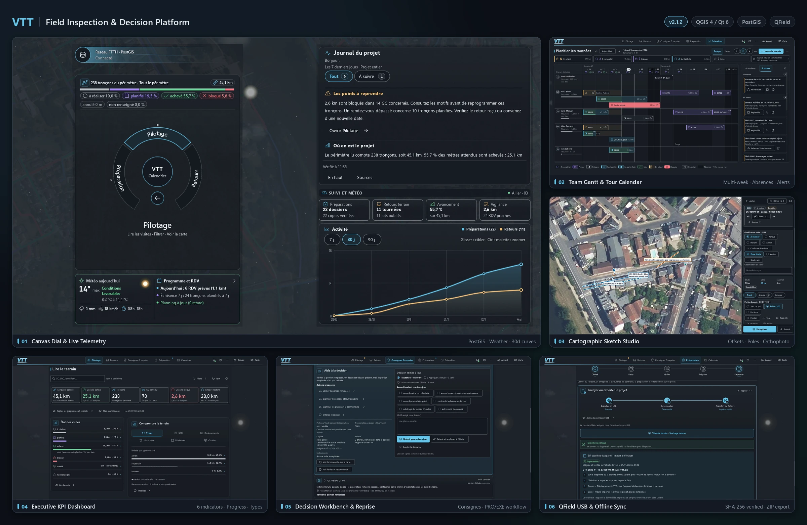
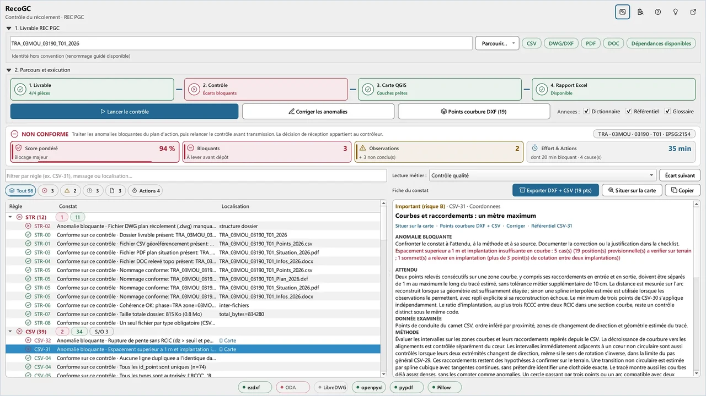
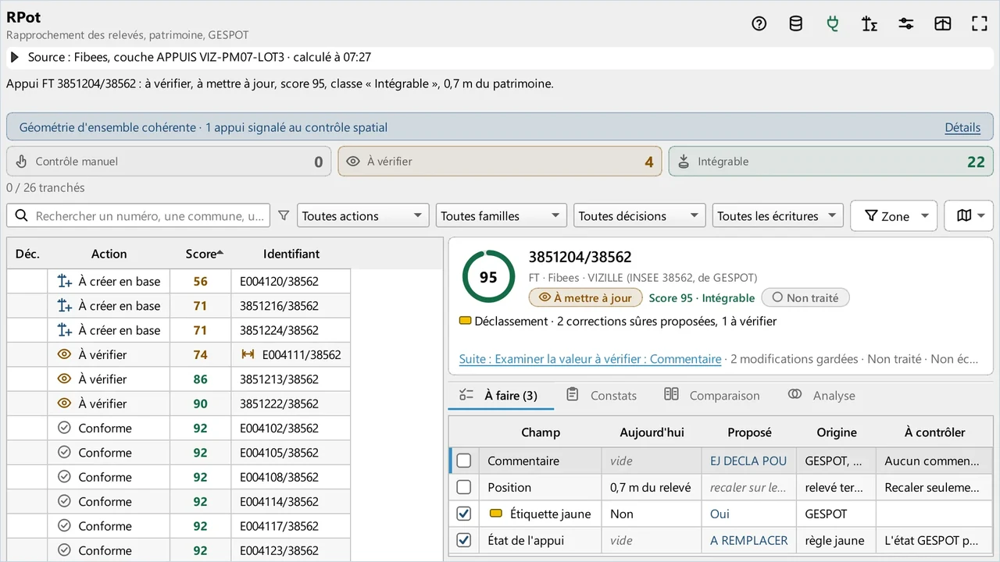
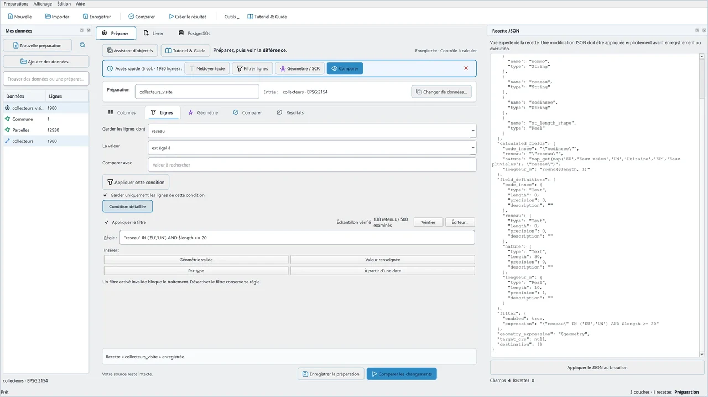
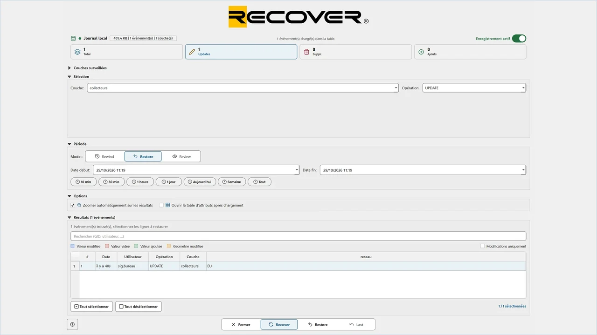
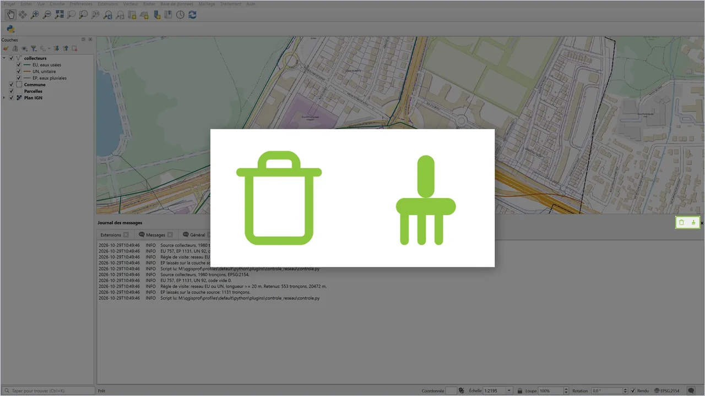
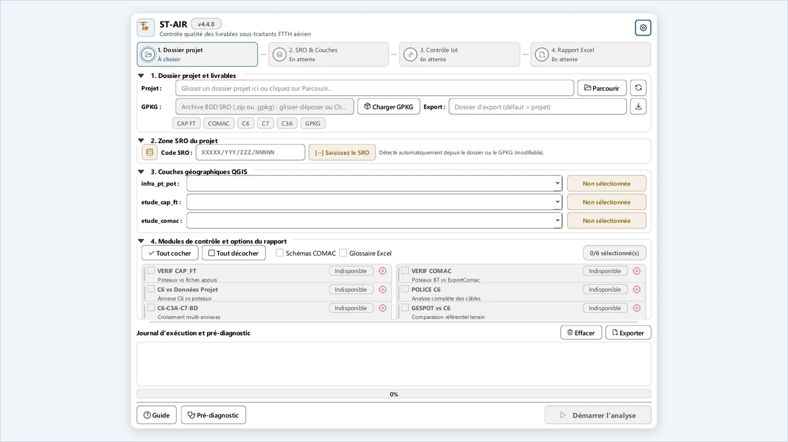
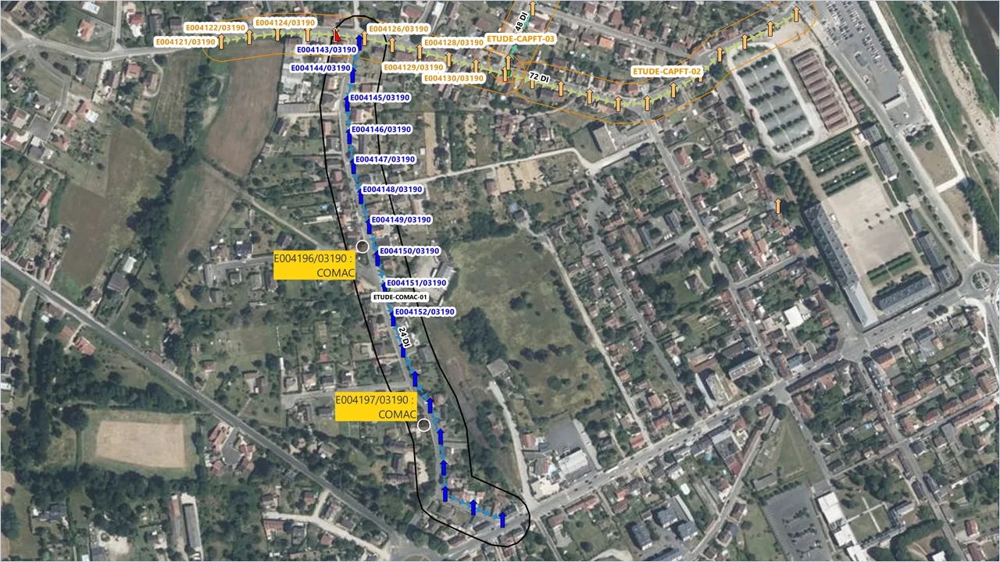
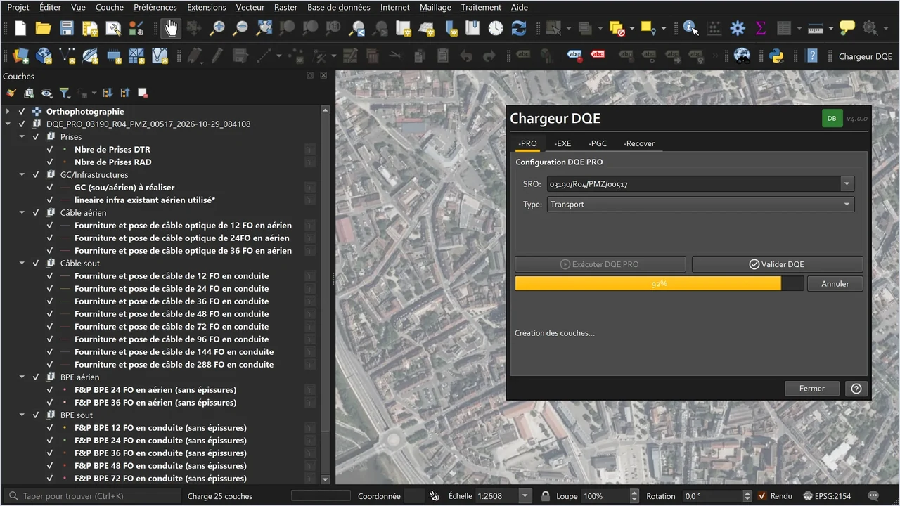

# Youcef ADDA

Geospatial Strategy Consultant ([GEODECI](https://geodeci.xyz/)).

## VTT

Field technical inspection and decision platform built on QGIS 4 / Qt 6, PostGIS, and offline QField (v2.1.2): live map dial, KPI dashboards, multi-week team Gantt calendar, cartographic sketch studio, decision workbench with PRO/EXE reprise, and SHA-256 USB/ZIP sync. ([Overview](https://geodeci.xyz/plugins/vtt))

## Field QA & reconciliation

<table>
  <tr>
    <td width="50%" valign="top">
      
       
      <strong>RecoGC</strong> - <a href="https://geodeci.xyz/plugins/recogc">Overview</a>
       
      Civil-engineering as-built quality control (REC PGC / CCTP 1592): 79 validation rules, QGIS anomaly map, what-if score simulation, and Excel audit report.
    </td>
    <td width="50%" valign="top">
      
       
      <strong>RPot</strong> - <a href="https://geodeci.xyz/plugins/rpot">Overview</a>
       
      Aerial pole reconciliation against PostGIS with GESPOT arbitration: confidence score, field-by-field comparison, dry-run preview, and transactional SQL rollback.
    </td>
  </tr>
</table>

## Open-source QGIS plugins

<table>
  <tr>
    <td width="50%" valign="top">
      
       
      <strong>Transformer</strong> - <a href="https://plugins.qgis.org/plugins/Transfomer/">QGIS Hub</a> | <a href="https://github.com/yadda07/Transformer">Source</a> | <a href="https://geodeci.xyz/plugins/transformer">Overview</a>
       
      Rule-based vector preparation, JSON recipes, Before/After comparison, and PostgreSQL/PostGIS publishing.
    </td>
    <td width="50%" valign="top">
      
       
      <strong>RecoverLand</strong> - <a href="https://plugins.qgis.org/plugins/RecoverLand/">QGIS Hub</a> | <a href="https://github.com/yadda07/recoverland">Source</a> | <a href="https://geodeci.xyz/plugins/recoverland">Overview</a>
       
      Local SQLite edit audit journal to search, compare, and restore layer modifications without server setup.
    </td>
  </tr>
  <tr>
    <td width="50%" valign="top">
      
       
      <strong>Log Cleaner</strong> - <a href="https://plugins.qgis.org/plugins/log_cleaner/">QGIS Hub</a> | <a href="https://github.com/yadda07/log_cleaner">Source</a> | <a href="https://geodeci.xyz/plugins/log-cleaner">Overview</a>
       
      One-click Message Log and Python bytecode cache cleanup in the QGIS Message Log panel.
    </td>
    <td width="50%" valign="top">
      
       
      <strong>ST-AIR</strong> - <a href="https://github.com/yadda07/stair">Source</a>
       
      Local QGIS quality control for aerial FTTH deliverables (CAP_FT, COMAC, C6, GESPOT), no server required.
    </td>
  </tr>
  <tr>
    <td width="50%" valign="top">
      
       
      <strong>PoleAerien</strong> - <a href="https://github.com/yadda07/poleaerien">Source</a> | <a href="https://geodeci.xyz/plugins/pole-aerien">Overview</a>
       
      Aerial network pole quality control and PostGIS synchronization (CAP_FT, COMAC, GraceTHD).
    </td>
    <td width="50%" valign="top">
      
       
      <strong>DQE Chargeur</strong> - <a href="https://github.com/yadda07/dqe">Source</a> | <a href="https://geodeci.xyz/plugins/dqe-chargeur">Overview</a>
       
      Bills of quantities generator (PRO, EXE, PGC) from PostGIS network data with replayable JSON archives.
    </td>
  </tr>
</table>

## PostgreSQL tools

- [Blackhole](https://github.com/yadda07/blackhole) - Centralized JSONB PostgreSQL audit log and point-in-time table recovery.
- [meta_ai_4_postgresql](https://github.com/yadda07/meta_ai_4_postgresql) - Schema-aware natural-language to SQL queries on PostgreSQL.

---

**Stack:** QGIS, PyQGIS, PostgreSQL/PostGIS, PL/pgSQL, Python, FME

[geodeci.xyz](https://geodeci.xyz/) | [contact@geodeci.xyz](mailto:contact@geodeci.xyz)
